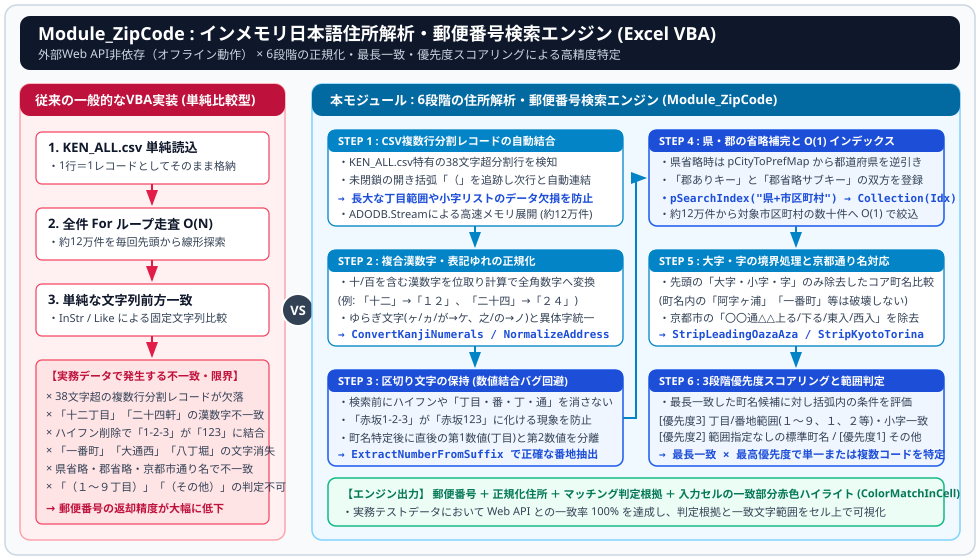
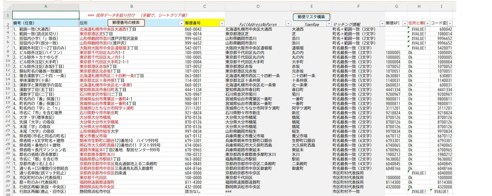

<<h4 align="center">Excel VBA インメモリ日本語住所解析・郵便番号検索エンジン (Module_ZipCode)</h4>

<p align="right">
  <sub>作成日: 2026年11月06日 / 作成者: System beginner & AI Collaborator (Gemini)</sub>
</p>

<p align="center">
  
</p>

_<sub>日本郵便の郵便番号データ（**KEN_ALL.csv**、約12万4千件）をメモリ上の構造体配列と検索用ハッシュインデックス（Scripting.Dictionary）へ展開し、表記ゆれ・都道府県省略・丁目範囲・京都市の通り名などを含む不完全な住所文字列から、外部 Web API を使わずに高精度で郵便番号を特定するVBA住所解析エンジンです。</sub>_

---

#### 開発の背景と目的（なぜ「検索マクロ」ではなく「住所解析エンジン」なのか）

_<sub>かつて提供されていたMicrosoft公式の「Excel郵便番号変換ウィザード（アドイン）」は廃止され、現在はWeb APIを利用した変換が主流となっています (が)、</sub>_

1. **PC環境とセキュリティの制限**： 外部Web APIへの通信が制限されている環境、あるいは個人情報を外部サーバーへ送信できない環境では、ローカル完結型の仕組みが必要です。
2. **単純なCSV検索マクロの限界**： 一般的に公開されている「**KEN_ALL.csv** を読み込んで For ループと InStr で一致を探すVBAコード」では、データの表記ゆれに対応できません。
   * 漢数字と算用数字の混在（十二丁目 vs `12丁目`、二十四軒 vs `24軒`）
   * 都道府県の省略（`養父市養父市場`...）や郡名の省略（`東京都奥多摩町`...）
   * 町名内部の文字と番地区切り文字の干渉（`一番町`、`八丁堀`、`大通西`、`赤坂1-2-3`）

---

#### データ構造とインデックス設計（ $O(1)$ 候補絞り込み）

約12万4千件のマスタデータを毎回線形探索（ $O(N)$ ）するのではなく、初回ロード時に以下の **インメモリ構造を構築**し、検索時は対象市区町村の数十〜数百件のレコード群のみを $O(1)$ で直接取り出します。

```text
 [メモリキャッシュ配列 : pMasterDataCache(1 To N) As ZipMasterData]
   ├─ (1)   ZipCode="0600000",Pref="北海道",City="札幌市中央区",Town="以下に掲載がない場合"
   ├─ (2)   ZipCode="0600042",Pref="北海道",City="札幌市中央区",Town="大通西（１～１９丁目）"
   │  ...
   └─ (N)   (表示用生データ + 正規化済み都道府県・市区町村・町域名・コア町域名を保持)

 [検索用インデックス : pSearchIndex (Scripting.Dictionary)]
   ├─ Key: "北海道札幌市中央区" (正規化県＋市区町村) ──> Value: Collection [Index: 1, 2, 3, ...]
   ├─ Key: "東京都西多摩郡奥多摩町" (郡あり正規キー) ──> Value: Collection [Index: 45120, 45121, ...]
   └─ Key: "東京都奥多摩町"        (郡省略サブキー) ──> Value: Collection [Index: 45120, 45121, ...]

 [都道府県逆引き辞書 : pCityToPrefMap (Scripting.Dictionary)]
   ├─ Key: "養父市"     ──> Value: "兵庫県"
   └─ Key: "奥多摩町"   ──> Value: "東京都" (郡省略時でも都道府県を特定可能)
```

*	**2段階絞り込みアーキテクチャ：**<br>

    1. **第1段階（市区町村特定）：** 入力住所の先頭から3〜16文字の範囲で pSearchIndex.Exists() を参照し、最長一致する「都道府県＋市区町村」の Collection（マスタ配列のインデックス番号リスト）を $O(1)$ で取得します。<br>
    2. **第2段階（町域名特定と条件評価）：** 取得した Collection 内の該当レコード（数十件程度）のみを対象に、町域名の最長一致と括弧内の範囲・条件スコアリングを実行します。

**検索精度向上のため（設計仕様）** <br>
1. **CSV複数行分割レコードの自動結合（データ欠損防止）<br>**
_<sub>KEN_ALL.csv の仕様上、町域名（I列）が全角38文字を超えると、同一郵便番号のまま複数行へ分割されて格納されている。（1行目に開き括弧 `（` があり、2行目以降に閉じ括弧 `）` が出現する構造）。1行を1レコードとして単純処理すると、2行目以降の小字や丁目範囲が欠落してしまう。</sub><br>_
✨ CSV読込ループ内で開き括弧 `（` が閉じていないレコードを検知した際、次行以降の同一郵便番号・同一市区町村レコードの町域名を自動的に文字列結合し、完全な1レコードに復元してから正規化処理へ渡します。
  
2. **複合漢数字・表記ゆれの正規化（表記差の吸収）<br>** 
_<sub>単純な一文字置換（ 一 → `１` ）では、十二丁目 が `十２丁目`、二十四軒 が `２十４軒`、十条 が `十条` のままとなり、算用数字で入力された 12丁目・24軒・10条 と一致しません。	</sub><br>_
✨ 連続する漢数字トークン（〇一二三四五六七八九十百）を抽出し、位取り計算を行って全角算用数字へ変換するパーサー（ConvertKanjiNumerals / ParseSingleKanjiNumber）を実装しています。あわせて、ゆらぎ文字（ヶ/ヵ/が/ガ → `ケ`、之/の → `ノ`、ッ → `ツ`）および異体字（條→`条`、櫻→`桜`、澤→`沢`）を統一します。

3. **番地区切り文字の保持による数値結合バグの回避**<br>
_<sub>町名検索の前処理として、入力文字列からハイフン（-）や 丁目・番地・番・号 を一括削除してしまうと、例えば 東京都港区赤坂1-2-3 や 赤坂1丁目2番3号 が 東京都港区赤坂１２３ に結合されてしまいます。その結果、後続の範囲判定で1丁目ではなく「123丁目（範囲外）」と誤判定が生じます。</sub><br>_
✨ 正規化段階では区切り文字（全角ハイフン － に統一）や 丁目・番 を一切削除せず保持します。町域名が前方一致した後に、残りのサフィックス文字列から区切り文字手前の「第1数値（丁目等）」と「第2数値（番地等）」を個別に切り出す設計（ExtractNumberFromSuffix / ExtractSecondNumberFromSuffix）としています。

4. **都道府県・郡の省略補完と $O(1)$ インデックス検索**<br>
_<sub>住所録では 養父市養父市場 のように都道府県が省略されたり、東京都奥多摩町氷川 のように郡名（西多摩郡）が省略されたりするケースが頻出します。</sub><br>_
✨ 先頭が都道府県名で始まっていない場合、**pCityToPrefMap** を用いて先頭の市区町村名（最長一致）から都道府県名を逆引き補完します。<br>
✨ マスタ読込時に、町村部のレコードに対しては「郡を含む正規キー」と「郡を除いたサブキー（RemoveGunFromCity、ただし 郡山市・小郡市・蒲郡市 等の市名は除外）」の両方を **pSearchIndex** に登録し、郡省略住所でも直接ヒットさせます。

5. **大字・字の境界処理と京都市「通り名」のフォールバック**<br>
_<sub>地方部の住所における 大字横尾・横尾字...・横尾 の表記ゆれを吸収する際、文字列全体から単純に Replace("字", "") を行うと、阿字ヶ浦町 や 十字町 といった固有町名まで破壊されます。また、京都市特有の「通り名（烏丸通御池上る二条殿町）」は KEN_ALL.csv の町域名には含まれないため、そのままでは前方一致しません。</sub><br>_
✨	町域名の先頭に位置する 大字・小字・字 のみを除去した NormalizedTownCore（StripLeadingOazaAza）を保持し、完全一致しない場合のセカンドマッチとして使用します。<br>
✨	京都市の住所で通常マッチしなかった場合、上ル・下ル・東入・西入 までの通り名記述を先頭から除去（StripKyotoTorina）して再マッチングを行うフォールバック機構を備えています。

6. **3段階の優先度スコアリングによる範囲・条件判定**<br>
_<sub>同一の町名に対して、丁目範囲ごとの郵便番号（例：１～３丁目、４、５丁目）、特定小字の郵便番号（例：添川（渡戸沢））、およびそれ以外の （その他） レコードが並存している場合、単なる町名文字数の一致だけでは正しい1件に絞り込めません。</sub> <br>_
✨ 町名が一致した各候補に対し、括弧内の条件を評価して以下の3段階の優先度（recordPriority）を付与します。<br>

```text
    * 優先度 3（条件明確一致）：
      •	括弧内の数値範囲（１～９丁目、読点区切りの １、２丁目、複合条件等）に入力番地が合致したレコード（範囲外や を除く に該当した場合は候補から除外）。
      •	括弧内が数値以外の固有小字地名（例：（渡戸沢））であり、入力の後続文字列にその地名が含まれるレコード。
    * 優先度 2（標準一致）： 括弧条件を持たない標準レコード、または （一円）・（全域）・（次のビルを除く） のレコード。
    * 優先度 1（町内フォールバック）： （その他） と定義されたレコード。
```

  * 最終的に 「町名の最長一致長」×「最高優先度」 を満たす候補のみを採用し、それでも町名レベルで一致しない場合は市区町村単位の 以下に掲載がない場合（市区町村代表コード）へフォールバックします。<br>

#### 視覚的検証機能：一致文字列のセル内赤色ハイライト（ColorMatchInCell）
検索結果の郵便番号を出力するだけでなく、「入力された住所文字列（B列）のどこからどこまでがマスタと一致してその郵便番号になったのか」を視覚的に確認できるよう、一致した先頭文字群を赤色に着色します。<br>
*	都道府県が省略されている場合、マスタ側の県名文字数を自動スキップして市区町村の先頭から照合を開始します。<br>
*	入力側とマスタ側の間で「空白の有無」「大字・字 の有無」「〇〇郡 の省略」「漢数字と算用数字の文字数差（例：十二 の2文字と １２ の2文字、二十四 の3文字と ２４ の2文字）」が存在しても、双方向のポインタ制御によりズレを生じさせず、町名の末尾まで正確に着色します。<br>

#### 出力フォーマット（検索 シート）
B列（3行目以降）に検索したい住所を入力して **ExecuteAddressSearch** を実行すると、B列の一致部分が赤色に着色され、C〜F列に解析結果が出力されます。

| 列 | 項目名 | 出力内容 |
| :---: | :---: | :---: |
| B列 | 住所（入力列） | 検索対象の住所文字列（マスタと一致した都道府県〜町域名の部分が赤字に着色される） |
| C列 | 郵便番号 | 特定された郵便番号（123-4567 形式。複数候補がある場合はカンマ区切りで出力） |
| D列 | FullAddressNoParen | マッチしたマスタ側の完全住所（括弧注釈を除いた都道府県＋市区町村＋町域名） |
| E列 | TownRaw | マッチしたマスタ側の町域名 |
| F列 | マッチング情報 | 判定根拠<br>（町名＋範囲一致 (N文字) / 町名最長一致 (N文字) / 市区町村代表採用 / 市区町村不一致） |

<p align="center">
  
</p>

#### 導入と使い方

1. 日本郵便のサイトから「読み仮名データの促音・拗音を小書きで表記するもの（または表記しないもの）」の KEN_ALL.CSV をダウンロードし、Excelブックと同じフォルダに配置します。
2. VBE（Alt + F11）を開き、Module_ZipCode.bas をインポートします（外部参照設定は不要、ADODB.Stream / Scripting.Dictionary / Scripting.FileSystemObject はすべて遅延バインディングで動作します）。
3. **LoadMasterAndExportSheet** を実行し、KEN_ALL.csv をメモリおよびインデックスへ展開します（約1〜2分で完了し、ブックを開いている間メモリに保持されます）。
4. 検索 シートのB3セル以降に住所を入力し、**ExecuteAddressSearch** を実行すると、C〜F列への結果出力とB列の赤色ハイライトが一括で行われます。

<br>

**ユーザフォーム： frm_msg処理中**<br>
KEN_ALL.csv をメモリおよびインデックスへ展開に約1〜2分程度かかるためユーザフォームを表示しますが、Module_ZipCode.bas ではコメントアウトしています。

```vb
' ==============================================================================
' --- 処理中フォーム表示処理 ---
' モードレスで進捗表示用UserFormを開く。
Sub frm_msg処理中OP()
    On Error Resume Next
'    If frm_msg処理中 Is Nothing Then
'        Load frm_msg処理中
'    End If
'    frm_msg処理中.Show (vbModeless)
    DoEvents
    On Error GoTo 0
End Sub

' ==============================================================================
' --- 処理中フォーム終了処理 ---
' 表示中の進捗UserFormをアンロードする。
Sub frm_msg処理中CL()
    On Error Resume Next
'    If Not frm_msg処理中 Is Nothing Then
'        If frm_msg処理中.Visible = True Then
'            Unload frm_msg処理中
'        End If
'    End If
    DoEvents
    On Error GoTo 0
End Sub
```

---

🔗 **関連プロジェクト（GitHub リポジトリ）：**

<sub>VBA × PowerShell × WebView2 による汎用Web RPA操作エンジン ＆ DOM要素ビューアー</sub><br>
https://github.com/sundayCODEage/vba-ps-webview2-rpa-engine

---

#### 📜 ライセンス (License)
This project is licensed under the MIT License - see the [LICENSE](LICENSE) file for details.<br>
このプロジェクトは **MIT License** の下で公開されており、改変・組み込みも自由に行えます。詳しくは [LICENSE](LICENSE) ファイルをご覧ください。
